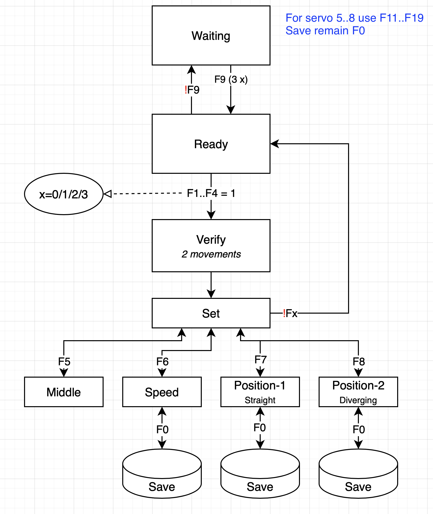

# Setting servo speed and end positions #
Configuration of servo speed and end positions (thresholds) can be performed via a normal DCC handheld. For that purpose, the decoder listens to the loco address: *7000 + Decoder address*.

Example: if the switch address on a Lenz LH100 is in the range of 397..400, the decoder address will be 99 (*400 / 4 - 1*) and the loco address 7099 (*7000 + 99*)). Note that this loco address can also be used for CV configuration via PoM.

The figure above shows the state diagram to configure the servos.

### Enter configuration mode ###
To enter configuration mode, F9 should be pushed tree times on, and two times off, within a period of three seconds.

### Select servo ###
The desired servo is selected via the function keys F1 .. F4 and F11 .. F14. F1 is for servo 1, F2 for servo 2, ..., F4 for servo 4, F11 for servo 5 and F12 for servo 6 (F13 and F14 for servo 7 and 8). Only servos up to the maximum of the board (CV64) can be selected.

Deactivating the function key will leave the configuration mode for that servo and allows other servos to be configured.

During configuration the switch position is not saved, and the polarisation relais (servo-2 board) and the RS-Bus feedback do not change. Once the function key is deactivated, the end positions and speed are restored from the CVs, as after a reset: changes that were not stored with F0 are lost. Thereafter the servo returns, via a normal movement, to the position it had when it was selected. If it is already at that side, it first moves away and back. This is the same as with configuration via PoM.

Servo speed and end positions can also be configured via PoM, for example by Programmer-Decoder-POM. See "Configuration via PoM" in ConfigurationVariables.md.

### Set middle position ###
By activating F5, the servo will move to the middle position (1500 us). Also both threshold values will be set to 1500 us.

### Set servo speed ###
F6 should activated be set the speed at which the servo moves. The default value is 6. Change the loco speed on the handheld to change this speed.

### End position straight (+) ###
Activate F7 to set the end position for the straight track (+, position 1 according to RCN-213). The servo first moves to the straight position. Whether this end position is threshold 1 (Min) or threshold 2 (Max) depends on the curves and InvertServoDir; the software determines this itself. If a loco speed is set, the position will slowly change. By increasing the loco speed, the change will be faster. By changing the loco direction, the position will change into the other direction.

### End position diverging (-) ###
Activate F8 to set the end position for the diverging track (-, position 0 according to RCN-213). The servo first moves to the diverging position.

### Store in EEPROM ###
Every time F0 is activated, the current setting will be saved in EEPROM.
