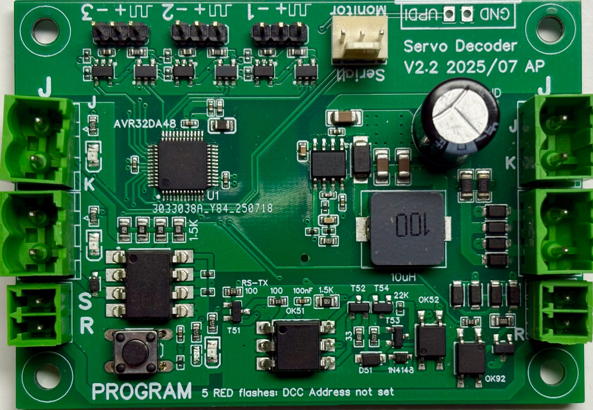
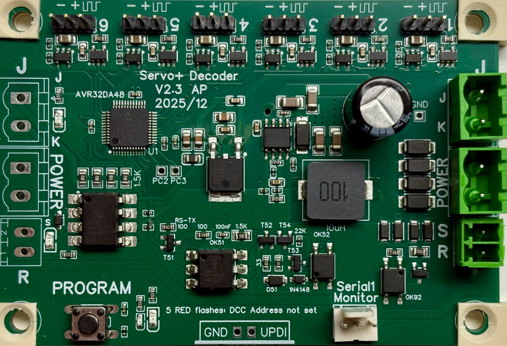

# AVR Servo Decoder #
DCC Servo decoder for boards with the AVR64DA28 (servo-2 board) or AVR32DA48 (servo-3 and servo-6 board) processor. For the capabilities of these boards, see the section on [Hardware](#Hardware) below. The main difference between this software and most other (open source) servo software projects, is that this software relies on high quality servo pulse generation, by taking advantage of the powerful peripherals that are exposed by the modern AVR processors. It uses the [Servo-TCA library](https://github.com/aikopras/Servo-TCA) for this purpose.

### Basic operation ###
The servo decoder listens to DCC (Digital Command Control) accessory commands and is able to switch two, three or six servos (the number of supported servos depends on the specific board, which is selected in hardware.h).

The accessory address at which the decoder is listening, can be set using the onboard (PROGRAM) button. After this button is pushed, the red LED flashes fast and the decoder will use the first accessory address that is received as its own address. Pushing the button for 5 seconds will reset CV1..CV63 to their default values and delete the decoder address; the servo specific CVs (CV65 and higher) keep their values.

### Setting servo speed and end positions ###
The end positions and the speed at which the servo moves, can be configured in three different ways:
- Using [a handheld](extras/EndPositions.md) for running trains.
- Using the [Programmer Decoder-POM](https://github.com/aikopras/Programmer-Decoder-POM) program. This program can read and write all CVs via PoM (Programming on the Main), including the servo end positions and speed. The end positions and speed can be set "live": the servo shows each change immediately.
- Using [Configuration Variables](extras/ConfigurationVariables.md) (CVs), via PoM or SM.

During configuration via the handheld or via the Programmer Decoder-POM, the white LED is on. After the configuration of a servo has finished, the servo returns to the position it had before.

### Selecting curves ###
Servo movements will follow the [curves](https://github.com/aikopras/Servo-TCA/blob/main/extras/Curves/curves.md) that are defined by the Servo-TCA library. Which curve will be used, can be determined by setting the corresponding CV. The default curve is Move-A.

### CVs ###
For the list of CVs and their meaning, see the [dedicated page](extras/ConfigurationVariables.md).

### RS-Bus feedback ###
The servo decoder is able to send feedback information via the (Lenz) RS-Bus. The RS-Bus address matches the DCC decoder address (which is switch address / 4), and is therefore set in conjunction with the DCC address.

In addition to sending feedbacks, this RS-Bus can also be used for reading CV values via PoM messages (RS-Bus address 128).

### LEDs ###
- Red LED: two short flashes after the decoder has started. Slow flashing: the decoder address is not set. Fast flashing: address programming (after the PROGRAM button is pushed). A single short flash for each switch command or PoM message for this decoder.
- White LED: on during configuration via the handheld or via the Programmer Decoder-POM.
- Servo-3 and servo-6 board only: a DCC LED (valid DCC signal) and a RS-Bus LED (valid RS-Bus signal).

### Software ###
The servo decoder software is written for the Arduino IDE with the [DxCore](https://github.com/SpenceKonde/DxCore) board definitions. The software requires the use of the [AP_DCC_Decoder_Core library](https://github.com/aikopras/AP_DCC_Decoder_Core) (which in turn uses the [AP_DCC_library](https://github.com/aikopras/AP_DCC_library) and the [RSbus](https://github.com/aikopras/RSbus) library), as well as the [Servo-TCA](https://github.com/aikopras/Servo-TCA) library (version 2.0.0 or later).

The sketch itself is in the folder [AVR-Servo](AVR-Servo). Before compiling, select the board in [hardware.h](AVR-Servo/hardware.h) (SERVO_2_BOARD, SERVO_3_BOARD or SERVO_6_BOARD) and the matching chip in the Arduino IDE (Tools => Chip): AVR64DA28 for the servo-2 board, AVR32DA48 for the servo-3 and servo-6 board. If the chip does not match the board, compilation stops with an error. hardware.h also lists the other compile settings (clock, millis timer, BOD, FLMAP). Debug output via the Serial1 Monitor connector is off by default.

##### UPDI #####
The software can be flashed via UPDI. On the servo-2 board, the UPDI pins are available from the 16-Pin IDC connector; the servo-3 and servo-6 board have a separate GND / UPDI connector. See the [instructions on the DxCore website](https://github.com/SpenceKonde/DxCore?tab=readme-ov-file#from-a-usb-serial-adapter-with-serialupdi-pyupdi-style---recommended) for details.

### Hardware ###
The software runs on three boards. The board is selected in hardware.h (SERVO_2_BOARD, SERVO_3_BOARD or SERVO_6_BOARD); the chip (Tools => Chip) should match the board.
- servo-2 board V2.0 (2022/07): AVR64DA28, 2 servos, 2 polarisation relays and 2 buttons.
- servo-3 board V2.2 (2025/07): AVR32DA48, 3 servos.
- servo-6 board V2.3 (2025/12): AVR32DA48, 6 servos.

The servo-2 board has an AVR64DA28 processor. The design of this board is open source, and it can be found on [OSHWLAB](https://oshwlab.com/aikopras/support-lift-controller_copy_copy_copy_copy). From there it can be imported into EasyEda and ordered at JLCPCB. The AVR64DA28 processor is a THT component, and can be ordered from companies such as Mouser.

This decoder board includes two relays that can be used to switch the polarity of frogs, as well as connectors for external buttons to switch the servos without the use of DCC.

The servo-3 and servo-6 board have an AVR32DA48 processor. The servo-3 board supports up to 3 servos, which is useful in combination with [Weinerts Mein Gleis DKW](https://www.h0-modellbahnforum.de/t321561f54854-RE-Weinert-Modellbau-raquo-mein-Gleis-laquo-23.html#msg3864004). The servo-6 board supports up to 6 servos, and can also be used for a double crossover (Hosentrager). These boards do not have onboard relays.

Servo-2 board:

Servo-3 board:

Servo-6 board:

### External links ####
- Schematics and PCB of the servo-2 board: https://oshwlab.com/aikopras/support-lift-controller_copy_copy_copy_copy (sorry for this strange URL)
- Programmer Decoder-POM (reading and writing all CVs, including the servo end positions): https://github.com/aikopras/Programmer-Decoder-POM
- Servo-TCA library: https://github.com/aikopras/Servo-TCA
- AP_DCC_Decoder_Core library: https://github.com/aikopras/AP_DCC_Decoder_Core
- DxCore board definitions: https://github.com/SpenceKonde/DxCore
- UPDI programming using a serial interface: https://github.com/SpenceKonde/DxCore?tab=readme-ov-file#from-a-usb-serial-adapter-with-serialupdi-pyupdi-style---recommended
- AVR64DA28 / AVR32DA48 Datasheet: https://ww1.microchip.com/downloads/aemDocuments/documents/MCU08/ProductDocuments/DataSheets/AVR64DA28-32-48-64-DataSheet-DS40002233.pdf
